# PayPerPhase

**Dental treatment you pay for phase by phase, on the day you receive it. Never in advance.**

PayPerPhase turns a Spanish dental *presupuesto* (quote) into a **pre-treatment, multi-phase plan with clinical healing windows**. It is **pay per phase**: the patient pays each phase with PayPal on the day it is delivered, so the money at risk if the clinic closes is **€0**. Built for Spain and EUR.

> Linked loans finance treatment you have not received yet. PayPerPhase lets PayPal finance only treatment you already have.

[](https://github.com/lgarbayo/payperphase/actions/workflows/ci.yml)
[](LICENSE)
<!-- REUSE badge: register at https://api.reuse.software/register, then add
     [](https://api.reuse.software/info/github.com/lgarbayo/payperphase) -->
<!-- OpenSSF Best Practices badge: create the project at https://www.bestpractices.dev/en/projects/new, then add the badge it gives you. -->
<!-- OpenSSF Scorecard badge: follow https://scorecard.dev/ ("Use the Scorecard GitHub Action"), then add
     [](https://scorecard.dev/viewer/?uri=github.com/lgarbayo/payperphase) -->

| | |
|---|---|
| **Hosted demo** | [payperphase.onrender.com](https://payperphase.onrender.com/?lang=en) (PayPal sandbox and Claude live; always on until 15 Dec 2026) |
| **Demo video (2:35)** | https://youtu.be/M7eus5cVwbo |
| **Built for** | [Build What's Next with PayPal and AI](https://paypalaihackathon.devpost.com/) (PayPal AI Hackathon 2026) |
| **Licence** | [MIT](LICENSE) |

> **Sandbox only.** Every payment runs in the PayPal sandbox and every patient is synthetic. In production, PayPal requires pre-approval for medical services.

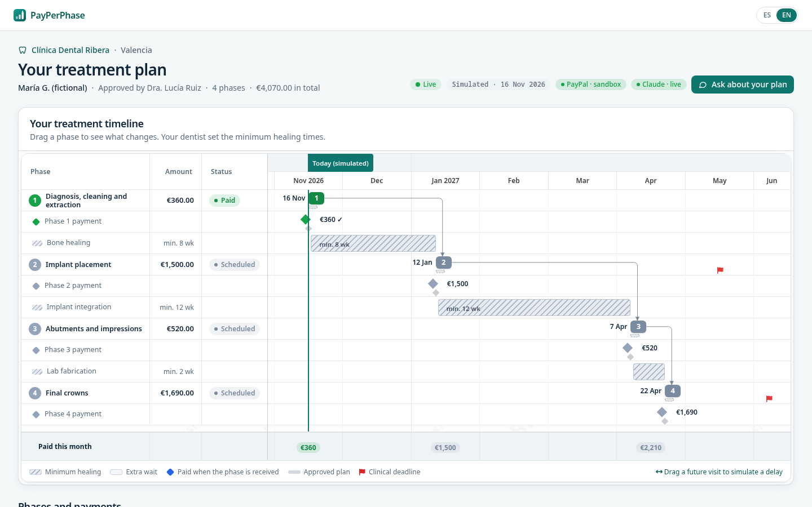

*Screenshots on this page are taken from a local build in labelled mock mode (`FORCE_MOCKS=1`), so they show "Mock" and "Cached" badges; the hosted demo runs PayPal sandbox and Claude live. The PayPal window is the real sandbox.*

The app has a dark product theme: near-black surfaces, hairline borders and one teal accent, with the Bryntum Gantt on Bryntum's own `svalbard-dark` theme.

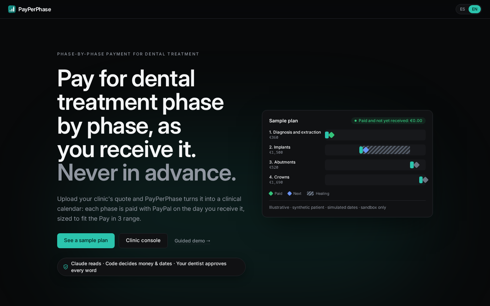

## What is new here
- **It starts from the quote, before treatment**, not from the bill afterwards. Claude reads the clinic's PDF; code checks every euro and tooth.
- **Biology sets the dates.** The dentist's minimum healing times are hard constraints: drag a phase too early on the Gantt and it snaps back, quoting the dentist.
- **PayPal Pay in 3 only ever finances care already received.** Each phase is sized for Pay in 3 (€20–€2,000), and the server refuses to create a PayPal order before the phase's visit.
- **The proof is one button.** "What if the clinic closes today?" puts the two models side by side: €3,710 to claim back with a linked loan, €0 with PayPerPhase.

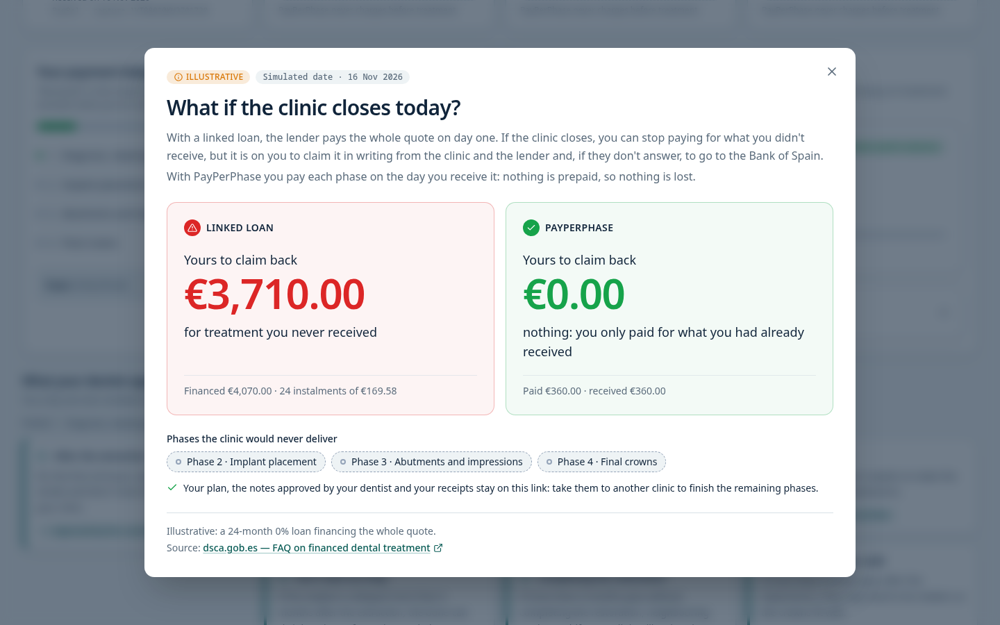

*Computed by the engine from the plan's state. Illustrative: a 24-month 0% loan financing the whole quote. Source: [dsca.gob.es](https://www.dsca.gob.es/es/consumo/preguntas-frecuentes/tenia-tratamiento-dental-financiado-entidad-que-propuso-clinica-pero).*

## The problem
In Spain most dental care is private. Multi-visit plans (implants, aligners, gum treatment) cost €2,000–€10,000 and arrive as one long quote. Patients either pay up front or sign a consumer loan linked to the clinic for the whole amount.

When the Dentix chain closed in 2020, **101,481 patients had paid for treatment they had not received, 65% of them with a linked loan** ([Spanish Ministry of Consumer Affairs, 17 Nov 2020](https://www.lamoncloa.gob.es/serviciosdeprensa/notasprensa/consumo/Paginas/2020/171120-dentix.aspx)). Two years earlier the iDental chain had collapsed the same way. With a linked loan you can stop paying for what you did not receive, but it is on you to claim it in writing from the clinic and the lender, and then from the Bank of Spain ([official guidance, dsca.gob.es](https://www.dsca.gob.es/es/consumo/preguntas-frecuentes/tenia-tratamiento-dental-financiado-entidad-que-propuso-clinica-pero)). The authority's own advice is: *«Recomendamos no pagar el importe total del tratamiento por adelantado»*, "we recommend not paying the full treatment in advance" ([dsca.gob.es](https://www.dsca.gob.es/es/consumo/notas-informativas/bienes-y-servicios/clinicas-dentales)).

PayPerPhase does that by default.

## For clinics: who pays, and why switch
- **The clinic is paid in full at every visit.** With Pay in 3, PayPal pays the merchant the whole phase amount at checkout and carries the instalments ([PayPal Spain: Paga a plazos](https://www.paypal.com/es/business/accept-payments/installment-payments)).
- **Who pays for it:** the clinic, at its usual PayPal transaction fee per phase. Pay in 3 is interest-free for the patient.
- **What the clinic gives up:** the lump sum on day one. That is the same incentive that let chains grow on patients' money.
- **What it gets:** a plan patients can read, quote-to-plan in minutes, and per-phase invoices, reminders and reconciliation done by an agent. It also gets a "we never charge in advance" promise it can show.
- **"Isn't Pay in 3 a loan too?"** Yes, but per phase, at 0%, decided by PayPal, and only for care delivered that day. PayPerPhase itself never lends.

## Proof on the PayPal sandbox
Every row was run against the real PayPal sandbox and the Anthropic API. The IDs can be looked up in the sandbox.

| What | Evidence |
|---|---|
| **Pay in 3 checkout inside the app**, on the hosted URL (11 Nov 2026, 15:26 CET) | Orders v2 order `9S058375J3368024G`, capture `1VT88810KH3701720`, EUR 360.00. The milestone turned green over SSE. |
| **Webhooks for that payment** | `PAYMENT.CAPTURE.COMPLETED` and `INVOICING.INVOICE.PAID`, both **signature verified** through `verify-webhook-signature` and de-duplicated ("already applied"). |
| **The agent closed the phase invoice** | `PPP-QBV8-F1-v1` → `MARKED_AS_PAID`. PayPal does not link a checkout capture to an invoice, so the agent's first `record_payment_for_invoice` was rejected and it recorded the payment as external. |
| A second in-app Pay in 3 run on the hosted URL | order `7KJ1289425611743W`, capture `60Y069311N401201C` |
| **Claude driving the PayPal Agent Toolkit** | Live run of 11 Nov, made before invoices moved to the visit day: 4 invoices created and sent in about 20 s. On a plan edit: `cancel_sent_invoice` → `create_invoice` v2 (€1,950.00) → held for a human Approve (sha256 of the exact payload) → `send_invoice` → QR code → reminder ([`docs/spikes/agent-toolkit.md`](docs/spikes/agent-toolkit.md)). |
| **The server, not the browser, sets the amount** | Order `8UF12137GP897594C` was created with the stored €360.00; the amount sent in the request was ignored. Phase 2, not yet due, was refused with `NOT_DUE_YET` ([`docs/spikes/paylater-es.md`](docs/spikes/paylater-es.md)). |
| **Live Claude extraction** of the hero quote | 12 of 12 lines exact, sum equal to the printed total, about 8.5 s |
| **Live patient chat** (Claude Haiku 5.5) | "What if I wait three months for the implant?" was answered with engine-computed dates and two citations of the dentist's approved notes. "Can I take ibuprofen?" was referred to the clinic. |

The **PayPal trail** in the clinic console shows the same chain for every phase: order, capture, verified webhook and the agent's invoice calls.

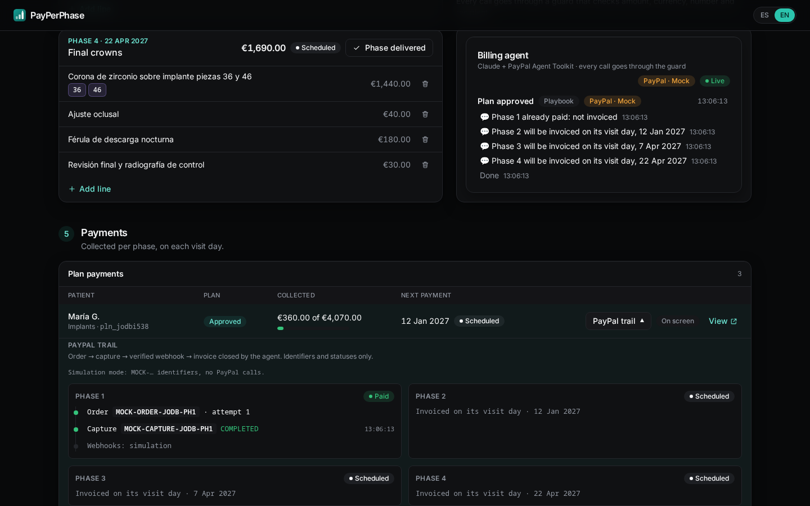

## Try it in 60 seconds
Open the [hosted demo](https://payperphase.onrender.com/?lang=en), or run it locally (see [Install](#install)). No account is needed for the first three steps.

1. Open **`/demo`**, the demo hub. Press **Reset demo** to return to the seeded state. It is public and safe to press at any time; the agent then issues phase 1's invoice in the sandbox again, because phase 1 is the only phase due on the seeded day.
2. Open **`/p/demo`**, the patient's plan for the synthetic case Clínica Dental Ribera (4 phases, €4,070 in total).
   - Drag a future phase on the Gantt. While you drag, the chart shades "Healing · not before …" and the "Safe window". Drop it too early and it snaps back with the dentist's note. Drop it later and the following phases and payments move with it, while the approved plan stays visible as a ghost.
   - Press **What if the clinic closes today?**.
   - Press **Ask about your plan** and ask "What if I wait three months for the implant?", then "How much is phase 2?" or "When do I pay phase 3?". Money answers are built by code from the engine's figures, never by the model.
   - Use the ES/EN toggle at the top right.
3. Open **`/clinic`**, the clinic console. Pick a sample presupuesto (or drop a PDF), watch the lines appear on the odontogram, approve the plan and watch the billing agent invoice phase 1, the only phase due today. The later phases get a note instead: each is invoiced on its visit day. Open **PayPal trail** on a plan to see order, capture, webhooks and invoice calls.
4. To pay phase 1 with the PayPal sandbox, use the sandbox buyer below.

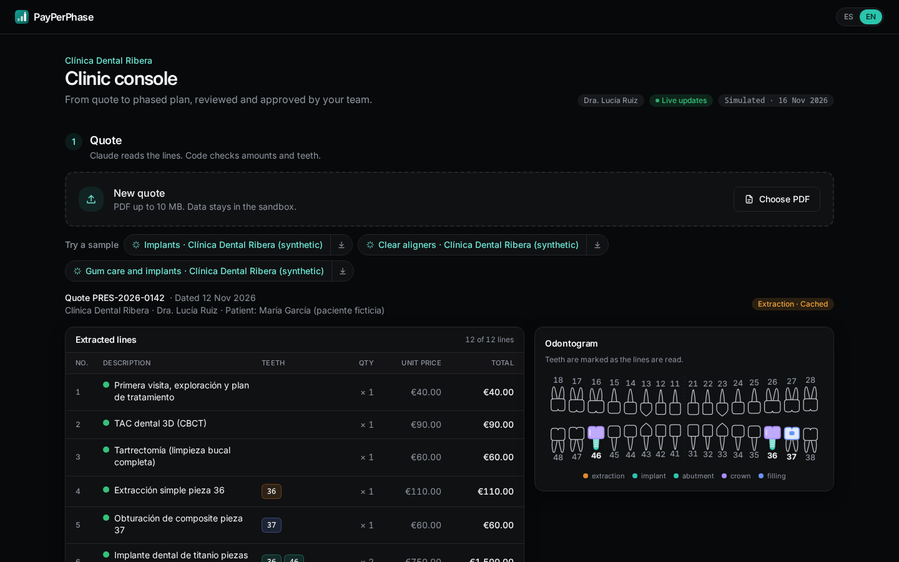

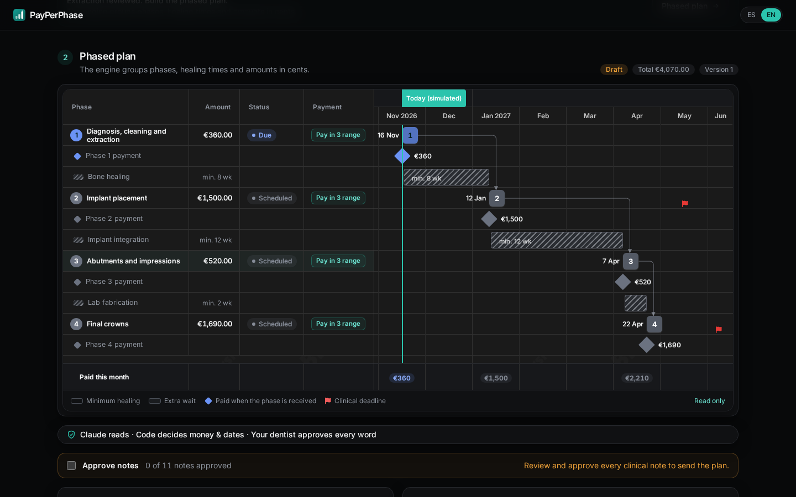

### Sandbox buyer login
Valid until **15 Dec 2026**. Use only on [sandbox.paypal.com](https://www.sandbox.paypal.com).

The sandbox buyer's email and password are in the **test credentials field of the Devpost submission**, visible to the judges. They are kept out of this public repository.

When PayPal's window opens, choose **Paga en 3 plazos**. It asks for a test DNI: the sandbox accepts `12345678Z`. Pick the sandbox card, tick the contract checkbox and complete the purchase (about 6 clicks). Paying with the PayPal balance is a single click.

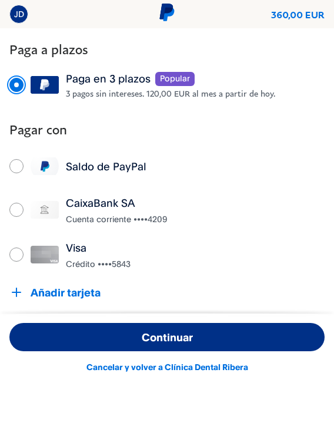

## Features
| # | Feature | Where |
|---|---|---|
| 1 | **A clinical Gantt.** Bryntum Gantt with dependencies and lags, hatched healing windows, payment diamonds coloured by PayPal status, a baseline ghost, a "Today (simulated)" line, clinical-deadline flags and a "Paid this month" summary row. It has a phone layout below 640 px. | [`src/components/gantt`](src/components/gantt) |
| 2 | **Pay each phase.** One PayPal Orders v2 checkout per phase, with the official Pay Later message unedited. Only today's phase is payable; a future phase shows a disabled pay button with "Paid on the day of your visit" under it. The milestone turns green live over SSE. | [`src/components/pay`](src/components/pay), [`src/lib/paypal`](src/lib/paypal) |
| 3 | **Drag what-if.** Dragging a phase moves its successors and due dates, all computed by the engine. An illegal drag snaps back with the dentist-approved reason, and going past the clinical deadline turns it red. | [`src/components/gantt`](src/components/gantt) |
| 4 | **"What if the clinic closes today?"** The engine computes what you would have to claim back on a linked loan for undelivered phases, against PayPerPhase's €0. It is labelled illustrative and sourced. | [`src/components/impact`](src/components/impact) |
| 5 | **The quote builds itself.** Claude Sonnet 5.5 reads the PDF while an FDI odontogram lights up tooth by tooth. A check bar computed in code shows Σ lines = printed total, invalid teeth and lines to review. Then the Gantt assembles. | [`src/components/clinic`](src/components/clinic), [`src/components/odontogram`](src/components/odontogram), [`src/ai/extract`](src/ai/extract) |
| 6 | **The billing agent.** Claude drives the PayPal Agent Toolkit to create, send and QR-code one invoice per phase, on that phase's visit day. A plan edit (the "+€450 bone graft" preset, added on the implant day) shows a plain-language diff and reissues that day's invoice after one Approve click. A guard rejects a wrong amount on camera and refuses an invoice for a phase that is not due yet. An overdue invoice gets a reminder as the simulated clock moves. | [`src/agent`](src/agent) |
| 7 | **Grounded patient chat.** Claude Haiku 5.5 answers only from the dentist's approved notes, with citation chips. A `simulate_delay` tool runs the engine, so every date comes from code, and a numeric grounding check rejects any number not in the sources. Money questions ("How much is phase 2?", "When do I pay phase 3?", "How much do I still owe?") skip the model: code answers them from the engine's plan data (phase amount, pay date, total, paid, remaining). Medical questions get a fixed referral to the clinic. | [`src/ai/chat`](src/ai/chat), [`src/components/chat`](src/components/chat) |
| 8 | **PayPal trail.** For each phase it shows order, capture, verified webhooks and the agent's invoice calls, with IDs and statuses only. | [`src/components/clinic/PayPalTrail.tsx`](src/components/clinic/PayPalTrail.tsx) |

Also included:
- Spanish and English wording through slot templates that code fills with engine values.
- Clinician approval of every patient note.
- An exposure meter ("paid for treatment not yet received").
- A return-reconcile page for the PayPal redirect fallback.
- Seeded synthetic cases: implants, aligners and periodontics.
- **Director Mode** for recording the video (`/demo?director=1`). Hotkeys: **R** reset, **1–6** beat states, **C** clock +7 weeks, **G** guard test, **H** hide the overlay.

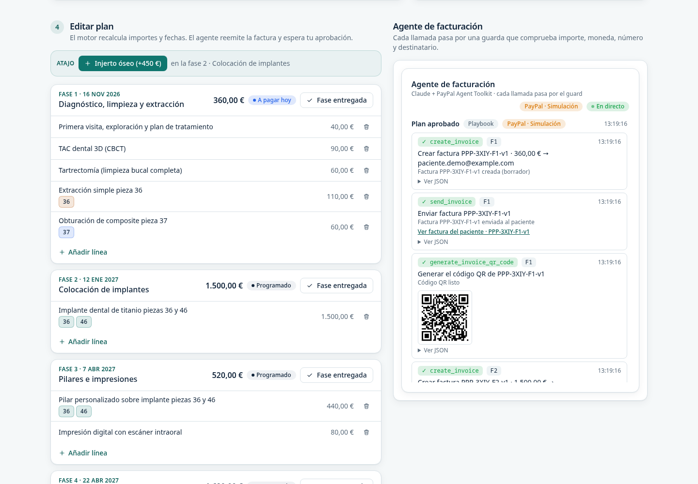

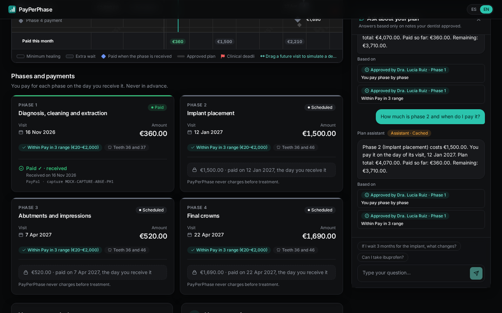

## Architecture
The design rule: **Claude reads, code decides money and dates, the dentist approves every word.**

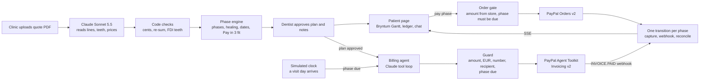

A fuller version is in [`docs/architecture/diagram.mmd`](docs/architecture/diagram.mmd), with a rendered copy in [`docs/architecture/diagram.svg`](docs/architecture/diagram.svg).

- **Money** is integer EUR cents produced only by the deterministic phase engine ([`src/engine`](src/engine)). The browser never sends an amount: the server reads it from the store. It creates an order only for a phase whose visit day has come, so the no-prepayment rule is enforced on the server.
- **Dates** are date-only values produced only by the engine. Bryntum draws them and never computes them: every task is manually scheduled. Dragging uses the same engine in the browser and on the server.
- **LLM output never contains money or dates.** Wording is drafted as slot templates, and a validator rejects any digit, currency sign or month name outside a slot. A dentist approves each text, and patients see only approved text. The chat's numbers must appear in its sources, or the answer is replaced.
- **The billing agent** can only call seven allow-listed invoice tools, and every call passes a deterministic guard (amount, currency, invoice number, recipient, and whether the phase is due). After a plan edit, sending needs one human Approve click on the exact stored payload.
- **Pay at the visit.** A phase's due date is its visit date. Its status runs scheduled → upcoming (not payable) → due → overdue, plus processing and paid. Its PayPal order and its invoice can exist only once the status is due or overdue, recomputed from the engine's dates at the simulated clock's today, never read from the store.
- **State** is one JSON file on a persistent disk, written atomically (temp file + rename) through a serial queue and validated with zod on every read. A domain event bus streams changes to every open page over SSE, and a labelled simulated clock drives the demo.

## PayPal APIs used and why
| API | Why |
|---|---|
| **Orders v2** (CAPTURE) | One one-time order per phase. Pay Later excludes recurring payments, so a subscription would not work. The amount comes from the store, with `custom_id` = plan and phase and a `PayPal-Request-Id` per attempt. |
| **JS SDK v5 + Pay Later messaging** | One button stack per phase (PayPal, Paga a plazos, card) and the official Pay Later message with the phase amount, shown unedited and pinned to the Pay in 3 offer for €20–€2,000. We stayed on v5 because that is the version we verified Pay Later messaging with, for a Spanish merchant in EUR ([`docs/spikes/paylater-es.md`](docs/spikes/paylater-es.md)). |
| **Webhooks** | `PAYMENT.CAPTURE.COMPLETED` and `INVOICING.INVOICE.PAID` confirm payments independently of the browser. They are verified through PayPal's `verify-webhook-signature` call and de-duplicated on the event id. |
| **Invoicing v2 via the Agent Toolkit** | One invoice per phase, created and sent with a QR code on the phase's visit day, a reminder when it goes overdue, and recording the checkout payment on the phase invoice. The toolkit is the only path, with no REST fallback ([`docs/spikes/agent-toolkit.md`](docs/spikes/agent-toolkit.md)). |

**Two PayPal rails, one ledger.** Checkout payments and invoice payments both go through one `transition()` per phase, so a phase can only be paid once. Neither rail can take money before the visit: the server refuses an order for a phase that is not due, and a phase has no invoice until its visit day. When a checkout captures, the agent closes that phase's invoice, so the patient cannot pay twice.

**PayPal edge cases handled:**
- `PayPal-Request-Id` on create and capture, so retries are idempotent.
- Order creation is serialized per phase: a double click or two open tabs get the same open order back instead of two orders for one phase.
- An order for an unknown plan → `404 PLAN_NOT_FOUND`.
- `INSTRUMENT_DECLINED` → `actions.restart()`, so the buyer can pick another funding source.
- `ORDER_ALREADY_CAPTURED` → reconcile instead of an error.
- A duplicate invoice number → bump to the next `v{k}` and retry.
- A phase that is not due yet → the order gate refuses it with `NOT_DUE_YET`, and the guard refuses `create_invoice` and `send_invoice` for it with `PHASE_NOT_DUE`.
- A capture, webhook or return for an order that does not match the server amount in EUR, or for a phase not yet due, is recorded but never settles the phase.
- The simulated clock jumps past a visit day → a phase that goes straight to overdue with no open invoice is invoiced then. A phase that goes overdue with an open sent invoice gets a reminder.
- A plan edit changes a future phase's amount → no invoice exists yet, so nothing is cancelled; the phase is invoiced with the new amount on its visit day.
- Webhook signature verification with de-duplication.
- A return-reconcile page for the redirect flow.
- The Agent Toolkit always runs with its sandbox flag set.

**Each phase invoice is issued on its visit day.** The billing agent creates and sends a phase's invoice, with its QR code, only once the phase is due: on its visit day, or later if the simulated clock jumped past it. Before that the patient has no invoice and no PayPal payment link for the phase; the clinic console's invoice preview and the PayPal trail show "Invoiced on its visit day" with the date. The guard enforces the rule whatever the model asks for: `create_invoice` or `send_invoice` for a phase that is not due, recomputed from the engine's dates at the simulated clock's today, is rejected with `PHASE_NOT_DUE`. So "never pay in advance" holds on both rails, checkout and invoice.

Why not send future-dated invoices at approval instead? PayPal makes an invoice with a future `invoice_date` `SCHEDULED`, and the sandbox then refuses `cancel_sent_invoice` and `send_invoice_reminder` on it with a 422, which would break the edit flow (cancel → reissue) and reminders. So each invoice is issued with no `invoice_date`, which dates it the day it is issued (the visit day), and the visit date goes on the line item. See [ADR-8](docs/ARCHITECTURE_DECISIONS.md#adr-8-each-phase-invoice-issued-on-its-visit-day).

## Bryntum Gantt: the API map
The Gantt is the product, not decoration. [Bryntum Gantt](https://bryntum.com/) (the public trial package; it shows a trial notice) is the only module that draws dates. Every task is `manuallyScheduled`: Bryntum renders, validates and animates, while the engine owns every date.

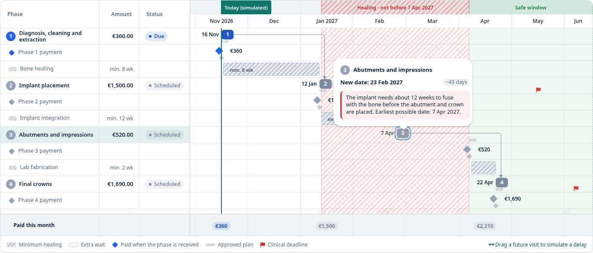

| Bryntum API | What it does here |
|---|---|
| `TaskDrag.validatorFn` + `tooltipTemplate` | Calls the engine's `validateMove` on every step of a drag. An invalid drop snaps back, and the tooltip quotes the dentist's note ("The implant needs about 12 weeks to fuse…"). |
| Time ranges added during a drag | "Healing · not before …" and "Safe window" zones, built from the engine's healing data and removed on drop. |
| `TimeRanges` with header elements | "Today (simulated)" and the clinical deadline. |
| `Baselines` with a per-baseline `cls` | The approved plan stays visible as a ghost during a what-if. A second style marks the chat's delay preview. |
| `Indicators` (custom `deadlineDate` item) | Clinical-deadline flags pinned to the exact day. The built-in early, late and constraint indicators are off. |
| `Dependencies` with lags | Healing intervals between phases. The tooltip shows the lag and the healing note, and creating dependencies is disabled. |
| `Labels` before and after | The visit date before each phase pill, and the amount after each payment diamond. |
| `Summary` | A "Paid this month" row under the chart. |
| `TaskMenu` with `processItems` | "Pay this phase" only on a payable phase, and "What if I delay it?" only on a future one. |
| `taskRenderer`, custom columns, `TaskTooltip` | Numbered phase pills; amount and status columns; tooltips in the patient's language. |
| Custom `viewPreset` | Month headers, with a blank top lane for the time-range labels. |
| `transition: { changeEvent: true }` | Successors glide into place when a plan update arrives, instead of jumping. |
| `LocaleManager` | Spanish and English, switched live with the app. |
| `svalbard-dark` theme | Bryntum's dark theme, tuned through CSS variables to the app's near-black surfaces and teal accent; healing stripes and phase numbers are contrast-checked for the dark background. |
| Editing features off | `taskEdit`, `cellEdit`, `taskResize`, `taskDragCreate` and others are disabled, so nothing in the chart can change a date behind the engine's back. |

**A parity test proves it.** [`tests/gantt/parity.test.ts`](tests/gantt/parity.test.ts) loads a real Bryntum `ProjectModel` in CI and checks, after Bryntum's own scheduling pass, that every date matches the engine's day for day, including after the demo's delay move.

## Deployed on Render
The hosted demo runs on [Render](https://render.com) from the Blueprint in [`render.yaml`](render.yaml) ([how to deploy](docs/deploy.md)).

[](https://render.com/deploy?repo=https://github.com/lgarbayo/payperphase)

| What | How it runs on Render |
|---|---|
| **Web service** | One Node 22 web service on the **Starter** plan in **Frankfurt**. It is always on, so it never sleeps while judges are clicking. Build: [`scripts/render-build.sh`](scripts/render-build.sh) (needs no secret); start: `npm start`. |
| **Persistent disk** | A **1 GB disk** mounted at `/var/data` (`DATA_DIR`) holds the JSON store, so the demo state survives deploys and restarts. The store reseeds itself if the file is missing. |
| **Health check** | `healthCheckPath: /api/health`. It returns the deployed commit (`RENDER_GIT_COMMIT`) and, for each integration, whether it is `live` or `mock`. It answers 503 if the disk store cannot be read or an env value is malformed, so a broken deploy never goes live. |
| **PayPal webhooks** | PayPal delivers `PAYMENT.CAPTURE.COMPLETED` and `INVOICING.INVOICE.PAID` to `https://payperphase.onrender.com/api/paypal/webhook`, where the signature is verified. |
| **Environment** | Every variable in `.env.example` is declared in the Blueprint. Secrets use `sync: false`, so Render asks for them at creation and they never live in git; each is optional, and a missing one puts that integration in labelled mock mode. [`tests/deploy/render-yaml.test.ts`](tests/deploy/render-yaml.test.ts) enforces this. |
| **Deploys** | Auto-deploy on every push to `main`. A build filter skips the deploy when a push only changes docs, fleet notes, tests or Markdown files. |
| **Free variant** | [`render.free.yaml`](render.free.yaml): the same service on the free plan, without a disk (it sleeps when idle and reseeds on restart). The same test keeps it in sync. |

The "Deploy to Render" button creates the service from `render.yaml`; PayPal and Claude keys are optional, so it starts in labelled mock mode.

```bash
curl https://payperphase.onrender.com/api/health   # output on 12 Nov 2026
# {"ok":true,"version":"c4ded02","modes":{"paypal":"live","paypalWebhooks":"live","anthropic":"live","agent":"llm"},"simToday":"2027-01-12"}
```

## AI components
Full statement: [`docs/submission/ai-tools.md`](docs/submission/ai-tools.md).
- **Quote extraction** (Claude Sonnet 5.5, structured output) reads the PDF into lines. Code parses the Spanish prices, re-sums the lines, compares them to the printed total and validates the FDI tooth numbers. A labelled cached extraction is the fallback.
- **Wording** (Claude Sonnet 5.5) drafts ES/EN slot templates for the patient notes, and the dentist approves them.
- **Clinic billing agent** (Claude Sonnet 5.5) runs a tool loop over the PayPal Agent Toolkit, behind the deterministic guard. It invoices each phase on its visit day, reissues an invoice after a plan edit, sends reminders for overdue invoices and closes an invoice when the checkout captures. A labelled deterministic playbook takes over when the model is unavailable.
- **Patient chat** (Claude Haiku 5.5) answers from the approved notes as cited documents. Its `simulate_delay` tool calls the engine; a numeric grounding check, a referral for medical questions and a rate limit keep it safe. Questions about what a phase costs or when it is paid never reach the model: code answers them from the engine's figures.
- **Claude Code** was used to build the project.

## Install
Requires Node 22 and npm.

```bash
git clone https://github.com/lgarbayo/payperphase.git
cd payperphase
npm ci
cp .env.example .env   # every secret is optional: a missing one runs that integration in labelled mock mode
npm run dev            # http://localhost:3000
```

Without PayPal and Anthropic keys the app still runs end to end in **labelled mock mode**. Every mock or cached path shows a visible badge, and the clock is always labelled "Simulated". For a fully offline run, set `FORCE_MOCKS=1`.

To go live, fill in the sandbox keys (see [`docs/sandbox-setup.md`](docs/sandbox-setup.md)) and deploy with [`docs/deploy.md`](docs/deploy.md).

### Usage examples
```bash
# Return the demo to its seeded state
curl -X POST http://localhost:3000/api/demo/reset

# See which integrations are live or mocked
curl http://localhost:3000/api/health
# {"ok":true,"version":"…","modes":{"paypal":"live","paypalWebhooks":"live","anthropic":"live","agent":"llm"},"simToday":"2026-11-16"}

# Read the hero plan the patient page shows
curl http://localhost:3000/api/plans/demo

# Ask the patient chat a what-if question (engine-computed dates, cited notes)
curl -X POST http://localhost:3000/api/chat -H 'content-type: application/json' \
  -d '{"planId":"<plan id from /api/plans/demo>","locale":"en","messages":[{"role":"user","text":"What if I wait three months for the implant?"}]}'

# Check a deployment end to end (add --browser to also check the Gantt in Chromium)
npx tsx scripts/demo-check.ts https://payperphase.onrender.com
```

### Configuration
All variables are listed in [`.env.example`](.env.example). Nothing in the repo contains a secret.

| Variable | Purpose |
|---|---|
| `PAYPAL_ENV` | Always `sandbox` |
| `PAYPAL_CLIENT_ID`, `NEXT_PUBLIC_PAYPAL_CLIENT_ID` | Sandbox REST app client id (the public one feeds the JS SDK and is inlined at build time) |
| `PAYPAL_CLIENT_SECRET` | Sandbox REST app secret (server only) |
| `PAYPAL_WEBHOOK_ID` | Id of the webhook registered at `/api/paypal/webhook` |
| `NEXT_PUBLIC_PAYPAL_BUYER_COUNTRY` | `ES` in the sandbox, so the Spanish Pay Later offer renders |
| `DEMO_PATIENT_EMAIL`, `DEMO_MERCHANT_EMAIL` | Sandbox buyer and business accounts; the guard invoices only the buyer |
| `ANTHROPIC_API_KEY` | Claude. If missing, the app uses the cached extraction, the playbook agent and the deterministic chat router, all with badges |
| `ANTHROPIC_MODEL_EXTRACT`, `_WORDING`, `_AGENT`, `_CHAT` | Model ids (Sonnet 5.5 by default; `_CHAT` defaults to Haiku 5.5) |
| `AGENT_MODE` | `auto` (default: the Claude tool loop when a key is set, otherwise the deterministic playbook), or `llm` / `playbook` to force one |
| `PUBLIC_BASE_URL`, `DATA_DIR`, `SIM_START_DATE`, `FORCE_MOCKS` | App URL, JSON store location, first day of the simulated clock, force every integration to mock |
| `PHASE_PAYMENT_INTENT` | `CAPTURE` (the only flow built) |

### Compatibility
| Environment | Status |
|---|---|
| Node 22 (`engines: >=22 <23`) | Supported; CI runs typecheck, tests and build on Ubuntu with Node 22 |
| Chromium (desktop, 1440 px) | Covered by the Playwright suites ([`tests/e2e`](tests/e2e)) |
| Phone width (below 640 px) | Responsive patient page and Gantt layout, checked by hand |
| Other modern browsers | Expected to work, not covered by automated tests |
| Languages | Spanish and English, with a key-parity test |
| PayPal | Sandbox only, an ES business app in EUR |

### Troubleshooting
| Symptom | Cause and fix |
|---|---|
| "Pagar (simulación)" / "Pay (mock)" instead of PayPal buttons | PayPal is in mock mode: `PAYPAL_CLIENT_ID` or `PAYPAL_CLIENT_SECRET` is missing, or `FORCE_MOCKS=1`. Set them and restart; `/api/health` should report `"paypal":"live"`. |
| No Pay Later message under the button | The message needs an ES merchant app, EUR and `NEXT_PUBLIC_PAYPAL_BUYER_COUNTRY=ES`. PayPal shows nothing when it has no offer for the amount. |
| A phase's pay button is disabled ("Paid on the day of your visit") | Only a phase whose visit day has come is payable. Move the simulated clock (Director key **C**) or reset the demo. |
| Webhooks never show "verified" | `PAYPAL_WEBHOOK_ID` must be the id of the webhook registered for this exact URL. `/api/health` reports `paypalWebhooks`. |
| The agent feed says "Playbook" | No `ANTHROPIC_API_KEY`, `AGENT_MODE=playbook`, or the model was unavailable. The run shows the reason, for example `HTTP 529 overloaded`. |
| `npm run dev` fails with `UnhandledSchemeError: node:crypto` | Node-only imports in `instrumentation.ts` must stay inside its `NEXT_RUNTIME === "nodejs"` block. |
| The demo state looks odd after many clicks | Press **Reset demo** on `/demo`, or `POST /api/demo/reset`. |
| `npm ci` cannot install `@bryntum/gantt` | It comes from the public trial alias. See "Bryntum registry fallback" in [`docs/deploy.md`](docs/deploy.md). |

### Testing
- `npm test` runs the Vitest suites (1,004 passing and 1 skipped, in 89 test files, on 12 Nov 2026). They cover:
  - property tests of the engine (cents, dates, dependencies, Pay in 3 fit, what-if, exposure);
  - the Gantt parity test and drag validator;
  - PayPal checkout and webhooks;
  - the agent guard and approvals;
  - Claude extraction and the chat against scripted clients, including the engine-built money answers;
  - i18n key parity, UI components and the docs checks.
- `npm run check` adds the typecheck.
- `npm run e2e` runs the Playwright demo path and Gantt drag suites against a mock-mode production build.
- CI runs typecheck, tests and build on every push to `main` and on every pull request.

### Project layout
```
app/                Next.js routes: / (landing), /demo, /clinic, /p/[planId], /api/*
src/contracts/      zod schemas and types shared by everything (plan, engine, agent, paypal, events)
src/engine/         deterministic phase engine: phases, healing, dates, cents, Pay in 3 fit, what-if, exposure
src/ai/             Claude extraction, wording and patient chat (money and dates never come from the model)
src/agent/          billing agent, guard, approvals, Agent Toolkit adapter, deterministic playbook
src/lib/paypal/     Orders v2, webhooks, return reconcile
src/server/         plan store (JSON), event bus and SSE, simulated clock, seed on boot
src/components/     gantt, patient, clinic, odontogram, chat, pay, impact, agent, director, brand, motion, shell
src/i18n/           Spanish and English dictionaries (slot templates filled with engine values)
data/ public/       seeded synthetic cases and generated sample presupuesto PDFs
docs/               deploy, sandbox setup, spikes, architecture, submission copy
fleet/              planning artefacts of the AI-agent workflow (idea, spec, work packages)
tests/              Vitest and Playwright suites
```

## Compliance and privacy
- **Sandbox only · synthetic patients · medical services require PayPal pre-approval in production.** This line is in the app footer, the video and here. PayPal's Acceptable Use Policy lists medical services as restricted, so a production launch would need that approval first.
- **GDPR:** all patient data is synthetic: fictional names, no real health data, no real PayPal accounts. Nothing personal is collected or stored. A real deployment would need a data-processing agreement with each clinic, a legal basis for health data and a DPIA before handling any real patient. Invoice lines would then read "Phase 2 · Clinic X" with no treatment names, and model calls would run under a data-processing agreement.
- Not medical advice. Clinical notes are written by the clinic and approved by the dentist.

## Hackathon milestones
- [x] PayPal developer dashboard: ES business sandbox app, Pay Later ES verified
- [x] Idea chosen and MVP defined (`fleet/IDEA.md`, `fleet/SPEC.md`)
- [x] Repo, MIT licence, stack; basic Claude call (live PDF extraction, 12 of 12 lines)
- [x] Sandbox test payment end to end (Orders v2, €360, PayPal balance and Pay in 3, captured)
- [x] AI core connected to PayPal (billing agent through the Agent Toolkit)
- [x] Frontend, UX and MVP features finished (odontogram, grounded chat, PayPal trail)
- [x] End-to-end flow on the hosted URL (in-app Pay in 3, verified webhooks, invoice closed by the agent)

## Submission material
[Devpost copy](docs/submission/devpost.md) · [AI tools statement](docs/submission/ai-tools.md) · [video script](docs/submission/video-script.md) · [submission checklist](docs/submission/checklist.md)

## Licence
[MIT](LICENSE)

## Contributing, security and support
- **Contributing:** setup, the project rules, tests and the pull request process are in [CONTRIBUTING.md](CONTRIBUTING.md). Expect a first response within 24–48 hours.
- **Security:** please report vulnerabilities privately, as described in [SECURITY.md](SECURITY.md), never in a public issue.
- **Conduct:** everyone taking part follows the [Code of Conduct](CODE_OF_CONDUCT.md).
- **History and design:** [CHANGELOG.md](CHANGELOG.md) says what changed and why, and [docs/ARCHITECTURE_DECISIONS.md](docs/ARCHITECTURE_DECISIONS.md) explains the main decisions and what we tried along the way.
- **Support:** open a GitHub issue for bugs and questions. The maintainer is Luis Garbayo Fernández.
