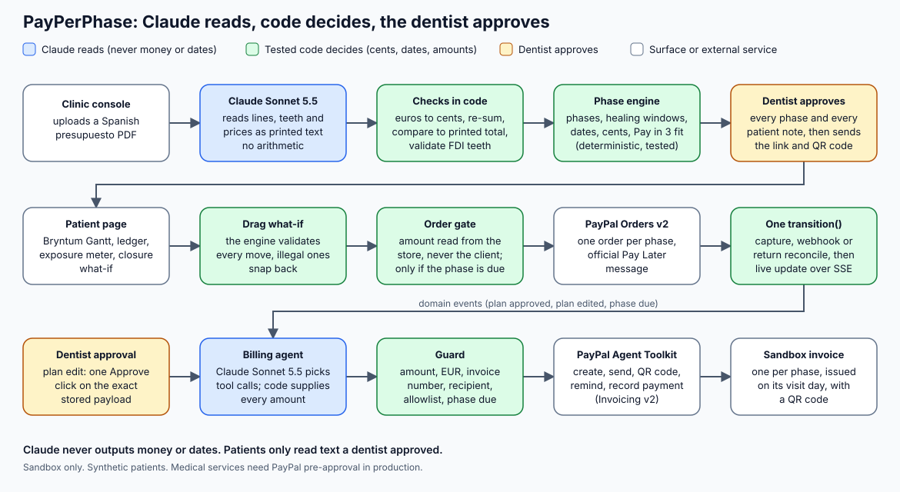

# PayPerPhase

**Dental treatment you pay for phase by phase, as you receive it. Never in advance.**

PayPerPhase turns a Spanish dental *presupuesto* (quote) into a **pre-treatment, multi-phase plan with clinical healing windows**. It is **pay per phase**: the patient pays each phase with PayPal on the day it is delivered, so the money at risk if a clinic closes is **€0**. Built for Spain and EUR. It is not a post-visit bill explainer and not a freelancer milestone tool.

Built for the [PayPal AI Hackathon 2026](https://paypalaihackathon.devpost.com/).

> **Sandbox only.** Every payment runs in the PayPal sandbox and every patient is synthetic. In production, PayPal requires pre-approval for medical services.

| | |
|---|---|
| **Hosted demo** | `TODO(human)`: Render URL, e.g. `https://<service>.onrender.com` (always-on through 15 Dec) |
| **Demo video (under 3 min)** | `TODO(human)`: public YouTube link |
| **Licence** | [MIT](LICENSE) |


## The problem
In Spain most dental care is private. Multi-visit plans (implants, aligners, gum treatment) cost €2,000–€10,000 and arrive as one long quote. Patients either pay up front or sign a consumer loan linked to the clinic for the whole amount. When the iDental (2018) and Dentix (2020) chains collapsed, thousands of patients kept repaying loans for treatment they never received ([official guidance from the Spanish consumer authority, dsca.gob.es](https://www.dsca.gob.es/ca/consumo/preguntas-frecuentes/tenia-tratamiento-dental-financiado-entidad-que-propuso-clinica-pero)).

PayPerPhase removes the mechanism: you pay each phase on the day you receive it, and the app proves it with an exposure meter that stays at €0.

## Try it in 60 seconds
No account is needed for the first three steps. Open the hosted URL (`TODO(human)`), or run it locally (see [Quick start](#quick-start)).

1. Open **`/demo`**, the demo hub. Press **Reset demo** to return to the seeded state (a public button, safe to press at any time).
2. Open **`/p/demo`**, the patient's plan for the synthetic case Clínica Dental Ribera (4 phases, €4,070 in total).
   - Drag a future phase on the Gantt: later phases and their payment dates follow, the original plan stays visible as a ghost. Drag it too early and it snaps back with the dentist's note.
   - Press **¿Y si la clínica cierra hoy?** (*What if the clinic closes today?*): a linked loan against PayPerPhase (€0).
   - Use the ES/EN toggle at the top right.
3. Open **`/clinic`**, the clinic console. Pick a sample presupuesto (or drop a PDF), watch the lines appear, approve the plan, and watch the billing agent issue the invoices.
4. To pay phase 1 with the PayPal sandbox, use the sandbox buyer below.

### Sandbox buyer login
Valid until **15 Dec 2026**. Use only on [sandbox.paypal.com](https://www.sandbox.paypal.com).

| | |
|---|---|
| Buyer email | `TODO(human)`: sandbox personal (ES) account email |
| Buyer password | `TODO(human)`: sandbox personal account password |

When PayPal's approval window opens, "Pay in 3" asks for a test DNI. The sandbox accepts `12345678Z`. Pick the sandbox card, tick the contract checkbox and complete the purchase (about 6 clicks). Paying with the PayPal balance is a single click.

Without PayPal and Anthropic keys the app still runs end to end in **labelled mock mode**: every mock or cached path shows a visible badge, and the clock is always labelled "Simulated".

## What is in this build
Mapped to the six wow moments of the demo script ([`fleet/SPEC.md`](fleet/SPEC.md)):

| # | Wow moment | What is on `main` |
|---|---|---|
| 1 | **A clinical Gantt** | Bryntum Gantt with dependencies and lags, hatched healing windows, payment diamonds coloured by PayPal status, a baseline ghost, a "today (simulated)" line and a clinical-deadline flag ([`src/components/gantt`](src/components/gantt)). |
| 2 | **Pay each phase** | One-time PayPal Orders v2 checkout per phase with the official Pay Later message, unedited. The milestone turns green live over SSE ([`src/components/pay`](src/components/pay), [`src/lib/paypal`](src/lib/paypal)). |
| 3 | **Drag what-if** | Dragging a phase moves its successors and due dates (computed by the engine). An illegal drag snaps back and shows the dentist-approved reason. Going past the deadline turns it red. |
| 4 | **"What if the clinic closes today?"** | The engine computes what a linked loan would still owe for undelivered phases against PayPerPhase €0. Labelled illustrative, sourced to dsca.gob.es ([`src/components/impact`](src/components/impact)). |
| 5 | **The quote builds itself** | Claude Sonnet 5.5 reads the PDF; lines stream in with tooth chips; a check bar reads "Σ lines = printed total · invalid teeth · to review" computed in code; the Gantt assembles ([`src/components/clinic`](src/components/clinic), [`src/ai/extract`](src/ai/extract)). |
| 6 | **The clinic agent** | A Claude agent drives the PayPal Agent Toolkit: `create_invoice` → `send_invoice` → `generate_invoice_qr_code` per phase. A plan edit (the "+€450 bone graft" shortcut) shows a plain-language diff and reissues the invoice after one Approve click. A guard rejects a wrong amount on camera (Director key **G**). Reminders follow the simulated clock ([`src/agent`](src/agent)). |

Also on `main`: Spanish and English wording through slot templates that code fills with engine values, clinician approval of every patient note, the exposure meter ("paid for treatment not yet received"), webhooks with signature verification and de-duplication, a return-reconcile page for the PayPal redirect fallback, seeded synthetic cases (implants, aligners, periodontics), and **Director Mode** for recording the video (`/demo?director=1`, hotkeys **R** reset, **1–6** beat states, **C** clock +7 weeks, **G** guard test).


**Not in this build yet** (in progress, so not claimed): the FDI odontogram graphic (the console shows tooth chips for now) and the grounded patient chat (the patient page labels the assistant as simulated).

## Architecture
The design rule: **Claude reads, code decides money and dates, the dentist approves every word.**



Source: [`docs/architecture/diagram.mmd`](docs/architecture/diagram.mmd) (Mermaid) and [`docs/architecture/diagram.svg`](docs/architecture/diagram.svg).

- **Money** is integer EUR cents produced only by the deterministic phase engine ([`src/engine`](src/engine)). The browser never sends an amount: the server reads it from the store, and an order is created only for a phase that is due (the no-prepayment rule is enforced on the server).
- **Dates** are date-only values produced only by the engine. Bryntum draws them (every task is manually scheduled) and never computes them. Dragging uses the same engine in the browser and on the server.
- **LLM output** never contains money or dates. Wording is drafted as slot templates; a validator rejects any digit, currency sign or month name outside a slot, and a dentist approves each text. Patients see only approved text.
- **The billing agent** can only call seven allow-listed invoice tools, and every call passes a deterministic guard (amount, currency, invoice number, recipient). After a plan edit, sending needs one explicit human Approve click on the exact stored payload.
- **Pay at the visit:** the phase's due date is the visit date. The status runs scheduled → upcoming (not payable) → due → overdue, plus processing and paid.

## PayPal APIs used and why
| API | Why |
|---|---|
| **Orders v2** (CAPTURE) | One one-time order per phase. Pay Later excludes recurring payments, so a subscription would not work. The amount comes from the store, with `custom_id` = plan and phase and a request id per attempt. |
| **JS SDK v5 + Pay Later messaging** | One button per phase and the official Pay Later message with the phase amount, shown unedited. Phases are sized for **Pay in 3** (€20–€2,000, 0%). |
| **Webhooks** | `PAYMENT.CAPTURE.COMPLETED` and `INVOICING.INVOICE.PAID` confirm payments independently of the browser, verified through PayPal's verify-webhook-signature call and de-duplicated on the event id. |
| **Invoicing v2 via the Agent Toolkit** | One invoice per phase, a QR code, reminders, and recording the checkout payment on the phase invoice. The toolkit is the default path, with no REST fallback in use (live run in [`docs/spikes/agent-toolkit.md`](docs/spikes/agent-toolkit.md)). |

Sandbox findings: [`docs/spikes/paylater-es.md`](docs/spikes/paylater-es.md) (Pay Later for a Spanish buyer in EUR) and [`docs/spikes/agent-toolkit.md`](docs/spikes/agent-toolkit.md).

## Bryntum features used
The Gantt is the product. [Bryntum Gantt](https://bryntum.com/) (the public trial package; it shows a trial notice) is configured with:
- clinical dependencies with lags between phases;
- healing windows drawn as hatched tasks;
- payment milestones coloured by PayPal status;
- a baseline ghost that keeps the original plan visible while a what-if runs;
- time ranges for the simulated "today" and the 6-month clinical deadline, plus a deadline marker;
- drag validation (`validatorFn`) wired to the engine, with snap-back and the dentist's note;
- custom columns (amount, status, payment form) and a custom task menu.

Browser proofs of the Gantt: [`docs/spikes/gantt/`](docs/spikes/gantt/).

## AI components
Full statement: [`docs/submission/ai-tools.md`](docs/submission/ai-tools.md).
- **Quote extraction** (Claude Sonnet 5.5, structured output): reads the PDF into lines. Code parses the Spanish money, re-sums the lines, compares to the printed total and validates the FDI tooth numbers. A labelled cached extraction is the fallback.
- **Wording** (Claude Sonnet 5.5): ES/EN slot templates for patient notes, approved by the dentist.
- **Clinic billing agent** (Claude Sonnet 5.5 tool loop over the PayPal Agent Toolkit): behind the deterministic guard, with a labelled deterministic playbook when the model is unavailable.
- **Claude Code** was used to build the project.

## Quick start
Requires Node 22.

```bash
npm ci
cp .env.example .env   # every secret is optional: a missing one runs that integration in labelled mock mode
npm run dev            # http://localhost:3000
npm run check          # typecheck + tests
npm run build          # production build
```

For a fully offline, labelled-mock run set `FORCE_MOCKS=1`. To go live, fill in the sandbox keys (see [`docs/sandbox-setup.md`](docs/sandbox-setup.md)) and deploy with [`docs/deploy.md`](docs/deploy.md) (Render Blueprint, health check at `/api/health`).

### Environment
All variables are listed in [`.env.example`](.env.example). Nothing in the repo contains a secret.

| Variable | Purpose |
|---|---|
| `PAYPAL_ENV` | Always `sandbox` |
| `PAYPAL_CLIENT_ID`, `NEXT_PUBLIC_PAYPAL_CLIENT_ID` | Sandbox REST app client id (the public one feeds the JS SDK) |
| `PAYPAL_CLIENT_SECRET` | Sandbox REST app secret (server only) |
| `PAYPAL_WEBHOOK_ID` | Id of the webhook registered at `/api/paypal/webhook` |
| `NEXT_PUBLIC_PAYPAL_BUYER_COUNTRY` | `ES` in the sandbox, so the Spanish Pay Later offer renders |
| `DEMO_PATIENT_EMAIL`, `DEMO_MERCHANT_EMAIL` | Sandbox buyer and business accounts; the guard invoices only the buyer |
| `ANTHROPIC_API_KEY` | Claude. Missing: cached extraction and playbook agent, with badges |
| `ANTHROPIC_MODEL_EXTRACT`, `_WORDING`, `_AGENT`, `_CHAT` | Model ids (Sonnet 5.5 defaults; `_CHAT` defaults to Haiku 5.5 and is reserved for the patient chat, not built yet) |
| `AGENT_MODE` | `auto` (default: Claude tool loop when a key is set, otherwise the deterministic playbook), `llm` or `playbook` to force one |
| `PUBLIC_BASE_URL`, `DATA_DIR`, `SIM_START_DATE`, `FORCE_MOCKS` | App URL, JSON store location, first day of the simulated clock, force every integration to mock |
| `PHASE_PAYMENT_INTENT` | `CAPTURE` (the only flow built) |

### Project layout
```
app/                Next.js routes: / (landing), /demo, /clinic, /p/[planId], /api/*
src/contracts/      zod schemas and types shared by everything (plan, engine, agent, paypal, events)
src/engine/         deterministic phase engine: phases, healing, dates, cents, Pay in 3 fit, what-if, exposure
src/ai/             Claude extraction and wording (money and dates never come from the model)
src/agent/          billing agent, guard, approvals, Agent Toolkit adapter, deterministic playbook
src/lib/paypal/     Orders v2, webhooks, return reconcile
src/server/         plan store (JSON), event bus and SSE, simulated clock, seed on boot
src/components/     gantt, patient, clinic, pay, impact, agent, director, brand
data/ public/       seeded synthetic cases and generated sample presupuesto PDFs
docs/               deploy, sandbox setup, spikes, architecture, submission copy
fleet/              spec, idea and work packages
tests/              Vitest suites
```

### Testing
`npm test` runs the Vitest suites: property tests of the engine (cents, dates, dependencies, Pay in 3 fit, what-if, exposure), the Gantt parity and drag validator, PayPal checkout and webhooks, the agent guard and approvals, Claude extraction against a scripted client, i18n key parity, UI components and the docs checks. `npm run check` adds the typecheck. CI runs typecheck, tests and build on every push.

## Compliance and privacy
- **Sandbox only · synthetic patients · medical services require PayPal pre-approval in production.** This line is in the app footer, the video and here. PayPal's Acceptable Use Policy lists medical services as restricted; a production launch would need that approval first.
- **GDPR:** all patient data is synthetic (fictional names, no real health data, no real PayPal accounts). Nothing personal is collected or stored. A real deployment would need a data-processing agreement with each clinic, a legal basis for health data and a DPIA before handling any real patient.
- Not medical advice. Clinical notes are written by the clinic and approved by the dentist.

## Hackathon milestones
- [x] PayPal developer dashboard: ES business sandbox app, Pay Later ES verified
- [x] Idea chosen and MVP defined (`fleet/IDEA.md`, `fleet/SPEC.md`)
- [x] Repo, MIT licence, stack; basic Claude call (live PDF extraction, 12 of 12 lines)
- [x] Sandbox test payment end to end (Orders v2, €360, PayPal balance and Pay in 3, captured)
- [x] AI core connected to PayPal (billing agent through the Agent Toolkit)
- [ ] Frontend, UX and MVP features finished
- [ ] End-to-end flow on the hosted URL

## Submission material
[Devpost copy](docs/submission/devpost.md) · [AI tools statement](docs/submission/ai-tools.md) · [video script](docs/submission/video-script.md) · [submission checklist](docs/submission/checklist.md)

## License
[MIT](LICENSE)

## Contributing, security and support
- **Contributing:** setup, the project rules, tests and the pull request process are in [CONTRIBUTING.md](CONTRIBUTING.md). Expect a first response within 24–48 hours.
- **Security:** please report vulnerabilities privately, as described in [SECURITY.md](SECURITY.md), never in a public issue.
- **Conduct:** everyone taking part follows the [Code of Conduct](CODE_OF_CONDUCT.md).
- **History and design:** [CHANGELOG.md](CHANGELOG.md) says what changed and why, and [docs/ARCHITECTURE_DECISIONS.md](docs/ARCHITECTURE_DECISIONS.md) explains the main decisions and what we tried along the way.
- **Support:** open a GitHub issue for bugs and questions. The maintainer is Luis Garbayo Fernández.
